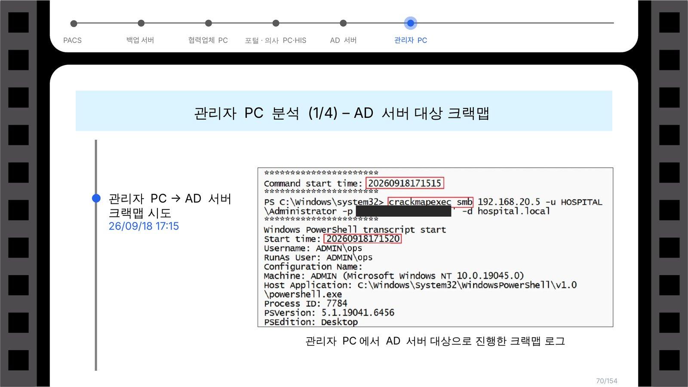
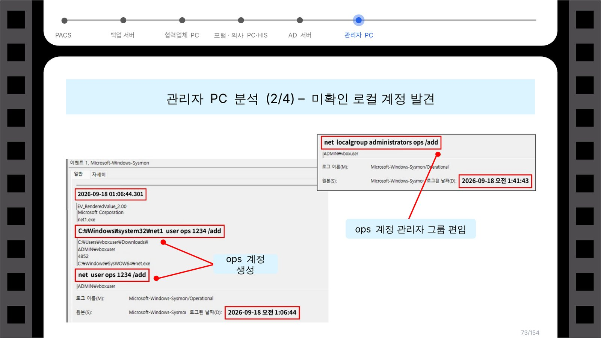
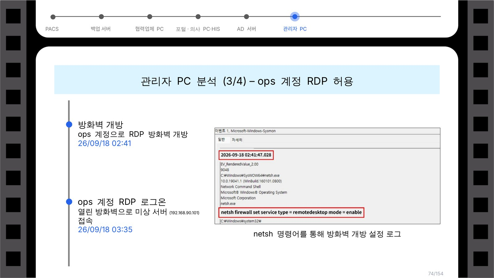
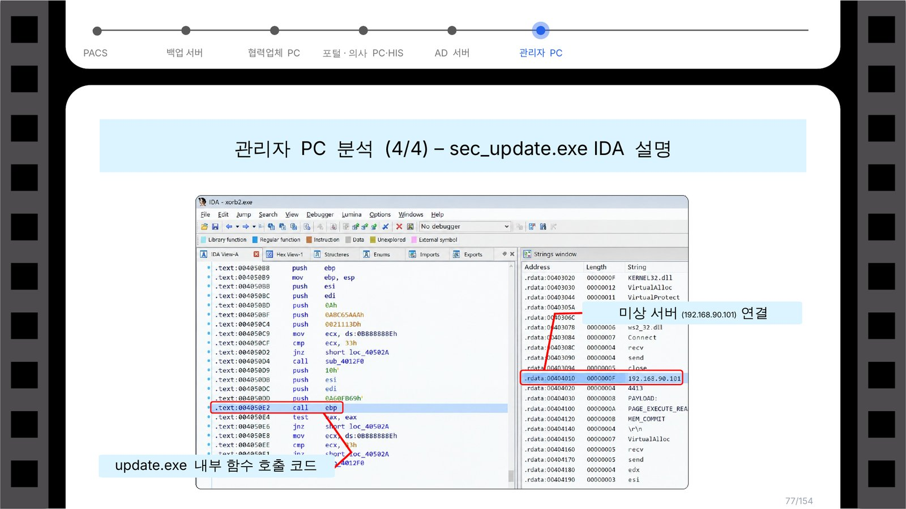
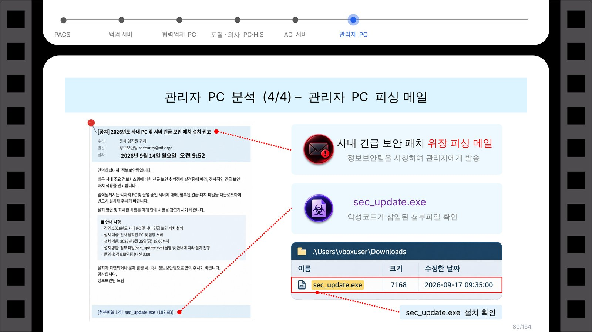

# 종합병원 랜섬웨어 침해사고 구현 및 포렌식 분석

> SK쉴더스 루키즈 32기 최종 프로젝트 · 2026.08 ~ 2026.10 · 10명 · 담당: 침해사고 구현, 관리자 PC 분석

 

## 프로젝트 개요

가상의 종합병원을 만들고, 그 안에서 스피어피싱부터 랜섬웨어 감염까지 공격을 직접 일으킨 뒤 남은 흔적으로 공격 경로를 거꾸로 추적한 프로젝트입니다.

- 행정망, 서버망, DMZ, 장비망 등으로 나눈 병원 네트워크 설계 (141대) 및 실제 구축 (17대)
- 팀 최종 보고서: 공격 타임라인, IoC, MITRE ATT&CK 매핑
- 피해 규모 산정 (141대 중 111대, 유출 약 130GB) 및 개인정보보호법상 신고 대상 여부 검토

 

## 내가 맡은 부분: 관리자 PC 분석

관리자 PC에 남은 기록으로 "공격자가 이 PC에 어떻게 들어왔고, 여기서 무엇을 했는지"를 찾았습니다.

| 시각 | 확인한 행위 | 근거 |
| --- | --- | --- |
| 2026-09-14 09:52 | 정보보안팀을 사칭한 "긴급 보안 패치" 피싱 메일 수신 | Thunderbird 메일 기록 |
| 2026-09-17 09:35 | 첨부파일 `sec_update.exe` 저장 및 실행 | Sysmon (Thunderbird가 파일 생성), Windows Defender 탐지 로그 |
| 2026-09-18 01:06 | 미확인 로컬 계정 `ops` 생성 | Sysmon 프로세스 생성 로그 (`net user`) |
| 2026-09-18 01:41 | `ops` 계정을 관리자 그룹에 추가 | Sysmon (`net localgroup administrators`) |
| 2026-09-18 02:41 | RDP 방화벽 개방 | Sysmon (`netsh firewall set service type=remotedesktop`) |
| 2026-09-18 03:35 | `ops` 계정으로 외부 미상 서버와 RDP 연결 | RDP 접속 이벤트 XML 로그 |
| 2026-09-18 17:15 | 관리자 PC에서 AD 서버 대상으로 CrackMapExec 실행 | PowerShell transcript |

`sec_update.exe`는 IDA로 열어 내부에서 미상 서버(C2)로 접속하는 코드를 확인했습니다.

 

## 분석 화면

**1. AD 서버 대상 CrackMapExec 실행 흔적** (실습 환경 비밀번호는 가림)

**2. 미확인 계정 `ops` 생성과 관리자 그룹 편입**

**3. 방화벽 개방과 RDP 접속**

**4. `sec_update.exe` IDA 분석 (C2 접속 코드)**

**5. 출발점이 된 피싱 메일**

 

## 사용 도구

Windows 이벤트 로그, Sysmon, Windows Defender 로그, Thunderbird 메일 기록, PowerShell transcript, IDA

 

---

모든 시스템, 계정, 메일은 프로젝트용으로 만든 가상 환경입니다. 팀 최종 보고서는 팀원 공동 작업물이라 공개하지 않고, 제가 맡은 부분만 정리했습니다.
