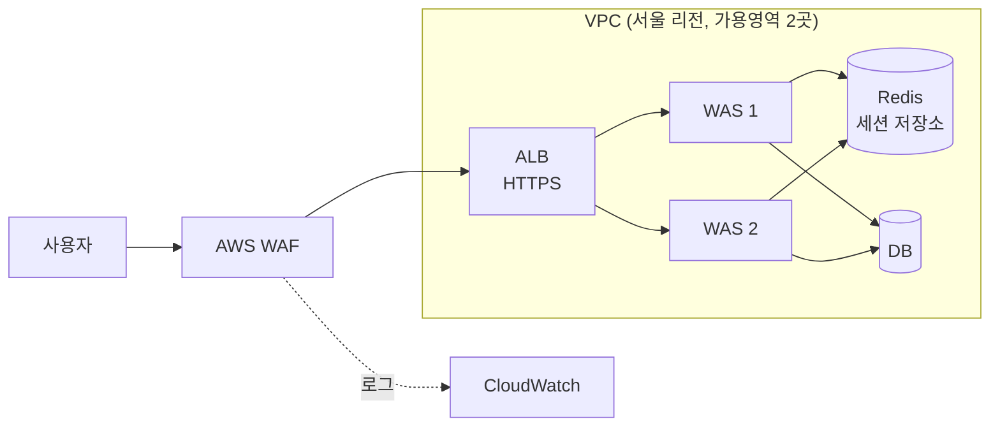

# AWS 인프라 Terraform 구축과 보안 점검

> SK쉴더스 루키즈 32기 클라우드 보안 · 2026.07 · 개인 (수업 실습)

 

## 개요

AWS 콘솔에서 손으로 만들던 3티어 구조를 Terraform 코드로 다시 만들고, 만든 계정을 오픈소스 도구로 점검했습니다. 강의 실습 코드를 바탕으로 변수와 구성을 제 환경에 맞게 바꿔 가며 구축했습니다.

 

## 구성

- public, WAS, DB 서브넷을 가용영역 두 곳에 나눠 총 6개로 구성
- Route 53 프라이빗 호스팅 존으로 내부 DB, Redis 주소 관리
- ACM 인증서로 ALB에 HTTPS 리스너 적용
- AWS WAF 관리형 룰 3종 (CommonRuleSet, KnownBadInputs, AmazonIpReputationList), 로그는 CloudWatch로 수집
- 코드는 provider, variables, network, security, route53, ec2, alb, waf, outputs 파일로 나눠 관리

 

## 막혔던 부분

| 문제 | 해결 |
| --- | --- |
| WAS가 2대라 요청이 다른 서버로 가면 로그인이 풀림 | WAS는 세션을 들고 있지 않게 하고, 세션을 Redis에 모아 관리 |
| ALB에 붙일 ACM 인증서 조회 결과가 비어 있음 | 인증서 종류를 코드에 고정하지 않고 변수로 빼서 선택하게 수정 |
| `terraform destroy` 후 다시 만들면 ALB 주소가 바뀌어 접속 불가 | 외부 DNS의 CNAME을 새 ALB 주소로 갱신, 남아 있던 옛 .tf 파일을 정리해 중복 에러 해결 |

 

## GitOps 연습

별도 저장소에서 `main` 브랜치에 push하면 GitHub Actions가 `terraform init`, `fmt`, `validate`, `plan`, `apply`를 자동으로 실행하도록 구성했습니다. 상태 파일은 S3 원격 백엔드에 두고, AWS 자격 증명은 GitHub Secrets로 관리했습니다.

 

## 계정 보안 점검

| 도구 | 내용 |
| --- | --- |
| ScoutSuite | 수업 실습으로 본인 AWS 계정 전체 점검, HTML 리포트 확인 |
| Prowler v5 | 개인 과제로 계정 전체 점검과 S3 버킷 퍼블릭 접근 점검, HTML/CSV 리포트를 정리해 보고서로 제출 |

 

## 사용 도구

Terraform, AWS (VPC, EC2, ALB, Route 53, ACM, WAF, CloudWatch, S3, IAM), Docker, GitHub Actions, Prowler, ScoutSuite
